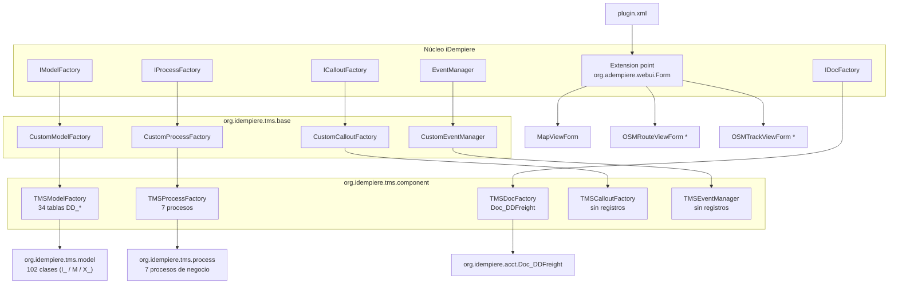
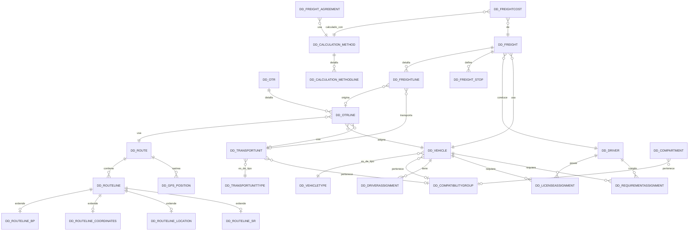
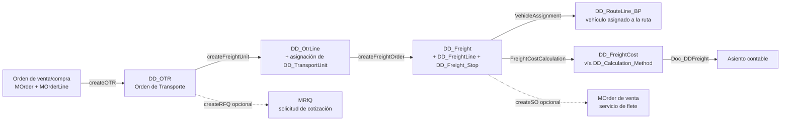

# org.idempiere.tms — Manual técnico

Transport Management System — plugin OSGi para iDempiere ERP

| Licencia | Versión | Tipo |
|---|---|---|
| GPL-2.0 | 2.0.1 Beta | eclipse-plugin |

> Generado por Claude Code a partir del clon local de `aguerra-ve/org.idempiere.tms`, commit `7441cf6` (2022-01-16). No se actualiza automáticamente con nuevos commits.

## Contenido

- [01 · Qué es y cómo instalarlo](#01--qué-es-y-cómo-instalarlo)
- [02 · Arquitectura OSGi](#02--arquitectura-osgi)
- [03 · Modelo de datos](#03--modelo-de-datos)
- [04 · Flujo de negocio](#04--flujo-de-negocio)
- [05 · Mapa de paquetes](#05--mapa-de-paquetes)
- [06 · Integración con Manufactura](#06--integración-con-manufactura)
- [07 · Dependencias externas](#07--dependencias-externas)
- [08 · Estado y problemas conocidos](#08--estado-y-problemas-conocidos)

---

## 01 · Qué es y cómo instalarlo

**org.idempiere.tms** es un plugin OSGi que añade un módulo de **gestión de transporte (TMS)** a iDempiere: flota de vehículos, conductores, licencias, rutas, seguimiento GPS, cálculo de costos de flete y su contabilización. Fue desarrollado por PShepetko (2019–2022) sobre el repositorio original `pshepetko/org.idempiere.tms`; este fork vive en `aguerra-ve/org.idempiere.tms`.

### Instalación (según el README del proyecto)

1. Descargar el `.jar` compilado desde la carpeta `downloads/` del repositorio.
2. Entrar a la consola web de **Apache Felix** de tu instancia iDempiere.
3. *Install plugin* → *Select file* → *Install and Update*.

El repo trae además una guía de usuario en PDF (`UserGuide_TMS_v1.0.2a.pdf`) dentro de `downloads/`.

> **Nota de compilación** — el `pom.xml` declara `packaging: eclipse-plugin` y depende de `org.idempiere.parent` (8.2.0-SNAPSHOT) por ruta relativa (`../../idempiere/org.idempiere.parent`): este módulo se compila dentro de un workspace Maven/Tycho que incluya el core de iDempiere al lado, no de forma aislada.

---

## 02 · Arquitectura OSGi

El plugin se conecta al core de iDempiere de dos maneras: **extension points** declarados en `plugin.xml` (para formularios) y **factories de servicio** registradas por código, envueltas por clases abstractas propias en `org.idempiere.tms.base` y activadas con implementaciones concretas en `org.idempiere.tms.component`.

*Fig. 1 — puntos de extensión OSGi y su ruta de registro. \* ver §08, la clase fuente no está presente en este checkout.*

---

## 03 · Modelo de datos

34 tablas propias (prefijo `DD_`), cada una con su trío estándar de iDempiere: interfaz `I_DD_*` generada, clase base `X_DD_*` generada, y clase de negocio `MDD*` con la lógica custom. Relaciones deducidas de las columnas `*_ID` declaradas en cada `X_DD_*`:

*Fig. 2 — entidades centrales y sus relaciones (subconjunto legible de las 102 clases; se omiten FKs a tablas del core como C_BPartner o M_Product).*

Cada entidad también referencia tablas del *core* de iDempiere: `C_BPartner` (socios de negocio / transportistas), `M_Product`, `C_Order` / `C_OrderLine`, `M_InOutLine`, `M_MovementLine`, `A_Asset` y `M_Warehouse` — el TMS se apoya en el modelo estándar en lugar de duplicarlo.

---

## 04 · Flujo de negocio

Los 7 procesos registrados en `TMSProcessFactory` encadenan una orden de venta/compra hasta el costo de flete contabilizado. La secuencia siguiente se reconstruyó a partir de qué modelos instancia (`new MDD*`) y qué campos lee/escribe cada clase en `org.idempiere.tms.process`:

*Fig. 3 — cadena de procesos, de línea de pedido a asiento contable.*

| Proceso | Qué hace | Crea / modifica |
|---|---|---|
| `createOTR` | Convierte una línea de orden en un requerimiento de transporte. | `MDDOTR`, `MDDOrderLine`, vínculo a `MInOutLine`/`MMovementLine` |
| `createFreightUnit` | Divide un OTR en unidades de transporte concretas. | `MDDOtrLine`, asigna `MDDTransportUnit` |
| `createFreightOrder` | Consolida OTRs en un flete real: ruta, vehículo, conductor, paradas. | `MDDFreight`, `MDDFreightLine`, `MDDFreightStop` |
| `VehicleAssignment` | Asigna un vehículo a una línea de ruta. | `MDDRouteLine_BP`, `MDDVehicle` |
| `FreightCostCalculation` | Calcula el costo del flete según el método de cálculo del acuerdo. | `MDDFreightCost`, usa `MDDCalculationMethod` |
| `createRFQ` | Genera una solicitud de cotización a transportistas. | `MRfQ` |
| `createSO` | Genera una orden de venta (servicio de flete a terceros). | `MOrder`, `MOrderLine`, `MBPartner` |

---

## 05 · Mapa de paquetes

| Paquete | Rol | Archivos |
|---|---|---:|
| `tms.model` | Entidades del dominio TMS (interfaz + base generada + clase de negocio). | 102 |
| `eevolution.fms.process` | Selectores de recursos para integración con Manufactura (eEvolution FMS) — ver §06. | 10 |
| `tms.base` | Envoltorios abstractos que adaptan las SPI de iDempiere para este plugin. | 9 |
| `tms.component` | Implementaciones concretas que registran modelos, procesos y el documento contable. | 6 |
| `tms.process` | Procesos de negocio ejecutables (ver Fig. 3). | 7 |
| `tms.util` | Utilidades: info del plugin, config del sistema, manejo de timestamps. | 3 |
| `tms.form` | Pantallas con mapa (ver §08 sobre formularios faltantes). | 1 |
| `tms.event` | Manejador de eventos de ejemplo, no registrado activamente. | 1 |
| `idempiere.acct` | Integración contable: genera el asiento de `DD_Freight`. | 1 |

---

## 06 · Integración con Manufactura

El paquete `org.eevolution.fms.process` (fuera del namespace `tms`) define cinco selectores de recursos — `ProcessingDriverSelection`, `ProcessingLicenseSelection`, `ProcessingRequirementSelection`, `ProcessingTransportUnitSelection`, `ProcessingVehicleSelection` — cada uno con su clase `*Abstract`. El nombre y el namespace `eevolution.fms` (Field/Facility Management Suite de eEvolution, el módulo de manufactura de iDempiere) sugieren que están pensados para que las órdenes de manufactura puedan seleccionar conductores, vehículos o unidades de transporte como recursos de un proceso productivo.

En este checkout los métodos de estas clases están vacíos (`// TODO Auto-generated method stub`): el andamiaje de integración existe, la lógica no está implementada.

---

## 07 · Dependencias externas

| Librería | Versión | Uso |
|---|---|---|
| Apache Axis | 1.4 | Cliente SOAP — probablemente para integraciones con servicios externos de rastreo/flota. |
| GraphHopper Directions API Client | 0.10.0 | Cálculo de rutas y direcciones; soporte de los formularios de mapa (`OSMRouteViewForm`, `OSMTrackViewForm`). |

Ambas se copian a `lib/` vía `maven-dependency-plugin` en la fase `validate` del `pom.xml`.

---

## 08 · Estado y problemas conocidos

- 🔴 **Falta código** — `plugin.xml` declara los formularios `OSMRouteViewForm` y `OSMTrackViewForm` como extensiones, pero sus clases `.java` no existen en `src/` de este checkout (solo `MapViewForm.java`). El plugin no compilará hasta agregarlas o quitar esas entradas del `plugin.xml`.
- 🔴 **Sin implementar** — los 5 selectores de `org.eevolution.fms.process` (§06) son stubs sin lógica.
- 🔴 **Factories vacías** — `TMSFormFactory`, `TMSCalloutFactory` y `TMSEventManager` están registradas pero su `initialize()` no registra nada — capacidad declarada, no usada.
- 🟢 **Contabilidad activa** — `TMSDocFactory` sí está completo y conecta `DD_Freight` al motor contable vía `Doc_DDFreight`.
